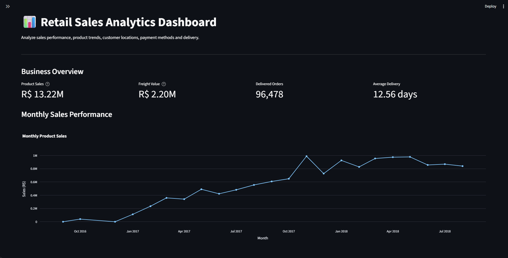

# Retail Sales Analytics API

A Python-based retail sales analytics project that transforms raw e-commerce data into structured insights using Pandas, SQLite, SQL, FastAPI, and Streamlit.

The project analyzes the Brazilian E-Commerce Public Dataset by Olist and provides analytical results through REST API endpoints and an interactive dashboard.

## Project Overview

This project implements an end-to-end data analytics workflow:

- Data inspection and cleaning using Pandas
- Data ingestion into a relational SQLite database
- SQL-based business analysis
- Python analytics functions
- REST API development using FastAPI
- Interactive dashboard development using Streamlit and Plotly
- API testing using Pytest

## Technology Stack

| Technology | Purpose |
|---|---|
| Python | Data processing and backend development |
| Pandas | Data cleaning and manipulation |
| NumPy | Numerical operations |
| SQLite | Relational database |
| SQL | Data analysis and querying |
| FastAPI | REST API development |
| Uvicorn | API server |
| Streamlit | Interactive dashboard |
| Plotly | Data visualization |
| Pytest | Automated testing |
| Requests | API communication |

## Dataset

**Brazilian E-Commerce Public Dataset by Olist**

Source: https://www.kaggle.com/datasets/olistbr/brazilian-ecommerce

The dataset contains information about customers, orders, products, sellers, payments, reviews, and geographical locations.

The project works with nine CSV datasets.

## Project Architecture

```text
Raw CSV Files
     |
     v
Data Inspection
     |
     v
Data Cleaning (Pandas)
     |
     v
Processed CSV Files
     |
     v
SQLite Database
     |
     v
SQL Analytics
     |
     v
Python Analytics Layer
     |
     v
FastAPI REST API
     |
     v
Streamlit Dashboard
     |
     v
Plotly Visualizations
```

## Project Structure

```text
Retail_Sales_Analytics_API/
│
├── dashboard/
│   └── app.py
│
├── data/
│   ├── Raw/
│   ├── processed/
│   └── retail_sales.db
│
├── reports/
│   └── cleaning_report.csv
│
├── sql/
│   ├── schema.sql
│   └── analytics.sql
│
├── src/
│   ├── inspect_dataset.py
│   ├── cleaning.py
│   ├── validate_cleaning.py
│   ├── database.py
│   ├── verify_database.py
│   ├── ingest.py
│   ├── verify_ingestion.py
│   ├── run_analytics_sql.py
│   ├── analytics.py
│   ├── test_analytics_manual.py
│   └── api.py
│
├── tests/
│   └── test_api.py
│
├── requirements.txt
├── .gitignore
└── README.md
```

## Database Design

The SQLite database contains nine tables:

1. Customers
2. Sellers
3. Products
4. Category Translation
5. Orders
6. Order Items
7. Order Payments
8. Order Reviews
9. Geolocation

Primary keys, foreign keys, and indexes are used to structure the relational database and support analytical queries.

## Key Analytical Findings

The following figures were obtained during the project's analysis:

| Metric | Result |
|---|---:|
| Total customers | 99,441 |
| Total orders | 99,441 |
| Delivered orders | 96,478 |
| Product sales (delivered orders) | R$ 13,221,498.11 |
| Freight value (delivered orders) | R$ 2,198,275.64 |
| Average delivery time | 12.56 days |
| Average days versus estimated delivery | -11.18 days |
| Average review score | 4.09 / 5 |

**Note:** Sales and freight figures above use delivered orders. Payment analysis and some SQL queries use different scopes, which are identified in the implementation.

## Dashboard Features

The Streamlit dashboard provides:

- Business overview KPIs
- Monthly sales performance
- Top products by sales
- Product category analysis
- Geographical sales by customer state
- Payment method analysis
- Order status distribution
- Delivery performance
- Expandable analytical data tables

## 📊 Dashboard Screenshots

The interactive Streamlit dashboard provides insights into sales performance, product trends, geographical distribution, order statuses, and delivery performance.

### 1. Dashboard Overview



### 2. Product Analysis


### 3. Geographical Sales Analysis


### 4. Order Status Distribution


### 5. Delivery Performance


## REST API Endpoints

| Method | Endpoint | Description |
|---|---|---|
| GET | `/` | API homepage |
| GET | `/sales/summary` | Sales summary |
| GET | `/sales/monthly` | Monthly sales |
| GET | `/products/top` | Top-selling products |
| GET | `/categories` | Category sales |
| GET | `/states` | Sales by customer state |
| GET | `/payments` | Payment analysis |
| GET | `/delivery` | Delivery performance |
| GET | `/orders/status` | Order status distribution |

Interactive API documentation is available through Swagger UI at `/docs`.

## Installation and Setup

### 1. Clone the repository

```bash
git clone https://github.com/Harsh4W/Retail-Sales-Analytics-API.git
cd Retail-Sales-Analytics-API
```

### 2. Create a virtual environment

```bash
python -m venv .venv
```

Activate it on Windows:

```powershell
.venv\Scripts\Activate.ps1
```

### 3. Install dependencies

```bash
pip install -r requirements.txt
```

### 4. Download the dataset

Download the Olist dataset from Kaggle and place its nine CSV files inside:

```text
data/Raw/
```

### 5. Initialize and populate the database

Run the following commands in order:

```bash
python -m src.inspect_dataset
python -m src.database
python -m src.cleaning
python -m src.validate_cleaning
python -m src.ingest
python -m src.verify_ingestion
```

Ensure that the database schema is initialized before running ingestion. Follow the implementation in `src/database.py` if the initialization command differs.

### 6. Run the FastAPI backend

```bash
uvicorn src.api:app --reload
```

API documentation:

```text
http://127.0.0.1:8000/docs
```

### 7. Run the Streamlit dashboard

Open a second terminal:

```bash
streamlit run dashboard/app.py
```

Dashboard:

```text
http://localhost:8501
```

### 8. Run automated tests

```bash
python -m pytest -v
```

## Testing

The API test suite contains 13 tests covering:

- Homepage response
- Sales summary
- Top products with default and custom limits
- Invalid and maximum query limits
- Monthly sales
- Product categories
- Sales by customer state
- Payment analysis
- Delivery performance
- Order status distribution

The previously verified test result was:

```text
13 passed
```

## Future Improvements

- Add interactive dashboard filters
- Improve geographical visualizations
- Add customer segmentation
- Develop predictive sales models
- Deploy the API and dashboard online
- Add more analytical test cases

## Author

Developed as a portfolio project to demonstrate practical skills in Python, SQL, data analytics, database management, REST API development, and data visualization.
